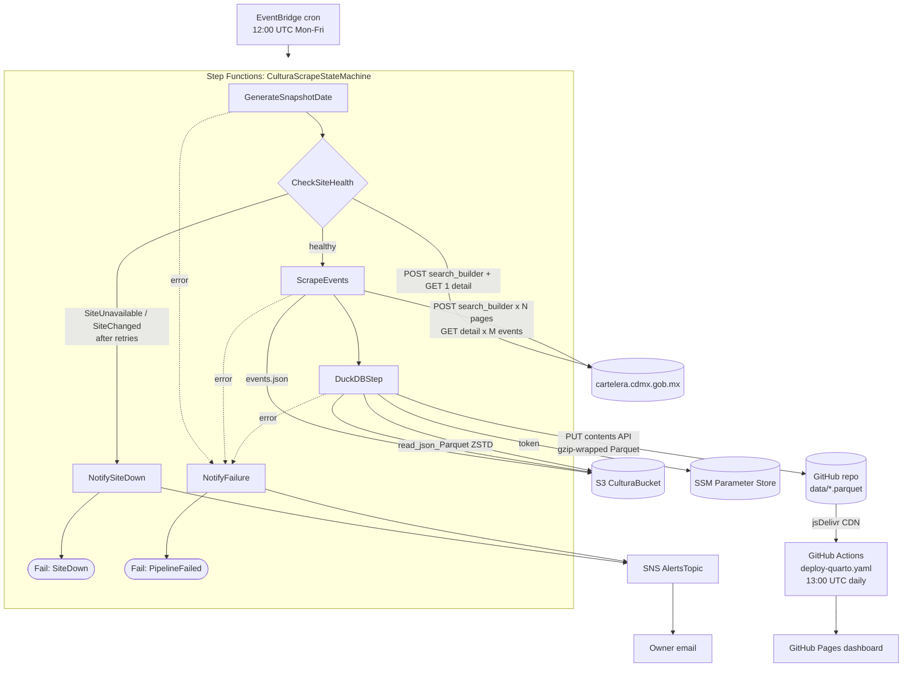
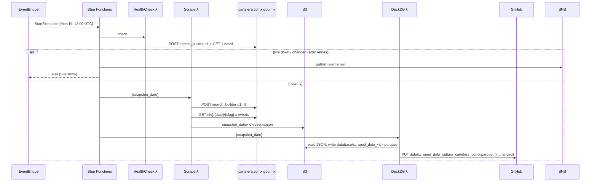

# AWS-SAM-Cultura-CDMX

Automated pipeline that collects the cultural events published on
[cartelera.cdmx.gob.mx](https://cartelera.cdmx.gob.mx), stores a daily snapshot as Parquet,
and publishes an interactive dashboard on GitHub Pages:
**"Explora Eventos Culturales en la CDMX"**.

> Document state: describes the HTTP/JSON scraper architecture (Playwright removed).
> See [Roadmap](#roadmap) for pending improvements.

---

## Overview

Every weekday an EventBridge rule starts a Step Functions state machine that:

1. creates a `snapshot_date` (`YYYYMMDD`, UTC);
2. **health-checks the source site** — if cartelera is down (or its markup changed) the run
   stops before scraping and an **email alert** is sent through SNS;
3. scrapes every event with plain HTTP requests against the site's internal JSON API and
   server-rendered detail pages (no headless browser);
4. merges the snapshot into a ZSTD Parquet with DuckDB and commits it to this repository
   (`data/scraped_data_cultura_cartelera_cdmx.parquet`), skipping the commit when nothing changed.

A daily GitHub Actions workflow renders `index.qmd` (Quarto dashboard + Observable JS) from that
Parquet and deploys it to GitHub Pages.

Running cost is roughly **$1 USD / month** before the changes in this version, dominated by ECR
image storage (~$0.57) and Secrets Manager (~$0.40); Lambda, Step Functions and S3 are
essentially free-tier. Removing the Playwright images and moving the token to SSM Parameter
Store removes both of those line items.

---

## Architecture Diagram



---

## Components

### Snapshot date — `GenerateSnapshotDateLambda`

**Location**: `cultura-cdmx-sam/generate_snapshot_date/app.py` (`lambda_handler`)

Returns `{"snapshot_date": "YYYYMMDD"}` in UTC. Every artifact of a run is namespaced by it.

### Site health check — `SiteHealthCheckFunction`

**Location**: `cultura-cdmx-sam/cartelera/health.py` (`lambda_handler`)

Cheap gate that runs before any scraping:

- `POST /api/v1/internal/events/search_builder` (page 1) must return HTTP 200, `status: "OK"`,
  at least one page and a non-empty event list;
- the first event's detail page must contain the embedded `cdmx_billboard_event_info` JSON.

Failure modes are raised as named errors that Step Functions matches on:

| Error | Meaning | Pipeline behavior |
|-------|---------|-------------------|
| `SiteUnavailable` | Network error, timeout, non-200, invalid JSON, empty listing | Retried by Step Functions after 5 and 10 min; then email + stop |
| `SiteChanged` | API works but detail pages no longer embed the expected JSON | Email + stop immediately (scraper needs updating) |

This replaces the old Playwright paginator check, which failed for weeks with
`Page.wait_for_selector: Timeout 20000ms exceeded` whenever the site was slow or down.

### Event scraper — `CarteleraScrapeFunction`

**Location**: `cultura-cdmx-sam/cartelera/scrape.py` (`lambda_handler`), helpers in
`cartelera/client.py` and `cartelera/parse.py`

1. Fetches listing page 1 from the JSON API to learn `event_pages_total`, then the remaining
   pages concurrently (thread pool, 6 workers, retries with exponential backoff).
2. For each listed event fetches `/{event_id}/{DD-MM-YYYY}/{slug}` and extracts the embedded
   `cdmx_billboard_event_info` JSON (description, schedule, costs, address, image, venue…).
3. Builds one record per listing item (`parse.build_record`) and writes a single JSON array to
   `s3://<bucket>/snapshot_date/<YYYYMMDD>/events.json`.

Guards: a listing page that keeps failing raises `SiteUnavailable`; more than 20% failed detail
pages raises `ScrapeDegraded` and nothing is written (yesterday's published data stays intact).
Emits CloudWatch EMF metrics under the `CulturaScraper` namespace.

The `schedule` field reproduces the site's own JavaScript: the earliest upcoming date (Mexico
City time) formatted like `Viernes, 9 De Octubre De 2026`, plus the event hours.

### DuckDB consolidation + publish — `DuckDBFunction`

**Location**: `cultura-cdmx-sam/duckdb_handler/app.py` (`lambda_handler`, `upload_to_github`),
layer `cultura-cdmx-sam/layers/duckdb/`

1. `COPY (SELECT * FROM read_json_auto('s3://…/snapshot_date/<d>/*.json')) TO
   's3://…/database/scraped_data_<d>.parquet' (FORMAT PARQUET, COMPRESSION ZSTD)`.
2. Downloads the Parquet, gzip-compresses it deterministically, reads the GitHub token from SSM
   Parameter Store and uploads it via the GitHub contents API as
   `data/scraped_data_cultura_cartelera_cdmx.parquet` (commit message
   `Add scraped parquet for <d>`).
3. If the git blob SHA is identical to the file already in the repo, the upload is skipped.

> **Note:** the file in `data/` is a **gzip-wrapped Parquet** (starts with bytes `1f 8b`).
> Decompress before reading, as `index.qmd` does.

### Alerts — `AlertsTopic`

SNS topic with an email subscription to the `NotificationEmail` stack parameter. The state
machine publishes directly to it (`arn:aws:states:::sns:publish`) from `NotifySiteDown` and
`NotifyFailure`. The email includes the snapshot date, error name, cause and execution ARN.

### Dashboard — `index.qmd` + `.github/workflows/deploy-quarto.yaml`

- Python chunk downloads the Parquet through jsDelivr
  (`cdn.jsdelivr.net/gh/dar4datascience/AWS-SAM-Cultura-CDMX@main/data/...`), un-gzips it, queries
  it with DuckDB and writes `events.json`.
- Observable JS cells provide text search, a range / multi-day calendar, an events table with
  posters, row selection and **iCal export** (`eventos-cdmx.ics`).
- The workflow runs daily at 13:00 UTC (and on demand), renders with Quarto and deploys to
  GitHub Pages.

---

## Data Flow



### S3 layout (`CulturaBucket`, objects expire after 30 days)

```text
snapshot_date/<YYYYMMDD>/events.json
database/scraped_data_<YYYYMMDD>.parquet
```

### Output schema

| Column | Type | Source |
|--------|------|--------|
| `page_number`, `card_index` | BIGINT | Position in the listing |
| `detail_url` | VARCHAR | `https://cartelera.cdmx.gob.mx/{event_id}/{DD-MM-YYYY}/{slug}` |
| `evento` | VARCHAR | `event_name` |
| `recinto` | VARCHAR | `venue_name` |
| `description` | VARCHAR[] | Paragraphs of `event_description` |
| `info` | VARCHAR[] | Duration, age, accessibility, costs, publisher |
| `schedule` | STRUCT(date, hour) | Next upcoming date label + hours |
| `location` | VARCHAR | `event_location.address` |
| `banner_url` | VARCHAR | `event_image` |
| `event_id`, `event_type`, `venue_id`, `event_url` | VARCHAR | Event metadata |
| `fecha_iso` | VARCHAR | Listing date `YYYY-MM-DD` |
| `lat`, `lon` | DOUBLE | Venue coordinates |
| `costs` | VARCHAR[] | `"name: price"` |
| `all_dates` | VARCHAR[] | Upcoming dates `YYYY-MM-DD` |

The first ten columns are the legacy schema the dashboard depends on.

---

## Configuration

| What | Where |
|------|-------|
| Stack name / region | `cultura-cdmx-sam/samconfig.yaml` (`cultura-cartelera-cdmx`, `mx-central-1`) |
| Scrape schedule | `CulturaScrapeScheduleRule` in `template.yml` — `cron(0 12 ? * 2-6 *)` |
| Dashboard schedule | `.github/workflows/deploy-quarto.yaml` — `0 13 * * *` |
| Alert recipient | Stack parameter `NotificationEmail` |
| GitHub token | SSM SecureString named by stack parameter `GithubTokenParameterName` (default `/cultura-cdmx/github-token`) |
| Target repo | `DuckDBFunction` env `GITHUB_OWNER`, `GITHUB_REPO` |
| Health-check retry policy | `CheckSiteHealth.Retry` in the state machine definition |
| Local page limit | `MAX_PAGES` env var for the scraper |

---

## Deploy

Prerequisites: AWS SAM CLI, credentials for the account, Python 3.12.

One-time: store the GitHub fine-grained token (contents: read/write on this repo) in SSM:

```bash
aws ssm put-parameter --region mx-central-1 \
  --name /cultura-cdmx/github-token --type SecureString --value '<token>'
```

Build and deploy from `cultura-cdmx-sam/`:

```bash
sam build
sam deploy --config-file samconfig.yaml \
  --parameter-overrides NotificationEmail=you@example.com
```

After the first deploy, **confirm the SNS subscription email** sent by AWS, otherwise alerts are
not delivered.

---

## Development & testing

```bash
uv venv --python 3.12 .venv && source .venv/bin/activate
uv pip install -r cultura-cdmx-sam/cartelera/requirements.txt duckdb pytest boto3

pytest cultura-cdmx-sam/tests -q                                   # offline unit tests
python scripts/run_scraper_local.py --max-pages 3 --out /tmp/c.json  # live, small run
```

Manual cloud runs:

```bash
aws stepfunctions start-execution --region mx-central-1 \
  --state-machine-arn <CulturaScrapeStateMachine-arn>

aws lambda invoke --region mx-central-1 --function-name <SiteHealthCheckFunction-name> \
  --cli-binary-format raw-in-base64-out --payload '{}' response.json
```

---

## Operations

- **Email "sitio cartelera no disponible"**: open <https://cartelera.cdmx.gob.mx/busqueda>. If it
  works again, start an execution manually; if events no longer load, the site is down.
- **Email with `SiteChanged`**: the site changed how it embeds event data — update
  `cartelera/client.py` (`fetch_event_info`) and the fixtures in `cultura-cdmx-sam/tests/fixtures/`.
- **Email with `ScrapeDegraded`**: too many detail pages failed; check the scraper's CloudWatch
  logs (`scrape_*` JSON log lines). Previous data remains published.
- Be polite to the source: concurrency is capped at 6 requests and the run happens once a day.

---

## Code References

| Component | File | Key Symbols |
|-----------|------|-------------|
| Infrastructure | `cultura-cdmx-sam/template.yml` | `CulturaScrapeStateMachine`, `AlertsTopic`, `CulturaScrapeScheduleRule` |
| Snapshot date | `cultura-cdmx-sam/generate_snapshot_date/app.py` | `lambda_handler` |
| HTTP client | `cultura-cdmx-sam/cartelera/client.py` | `fetch_listing_page`, `fetch_event_info`, `slugify`, `SiteUnavailable`, `SiteChanged` |
| Record builder | `cultura-cdmx-sam/cartelera/parse.py` | `build_record` |
| Health check | `cultura-cdmx-sam/cartelera/health.py` | `lambda_handler` |
| Scraper | `cultura-cdmx-sam/cartelera/scrape.py` | `lambda_handler`, `ScrapeDegraded` |
| Publish | `cultura-cdmx-sam/duckdb_handler/app.py` | `lambda_handler`, `upload_to_github` |
| Tests | `cultura-cdmx-sam/tests/` | fixtures from real pages |
| Local runner | `scripts/run_scraper_local.py` | — |
| Dashboard | `index.qmd`, `styles.css`, `_quarto.yml` | `allEvents`, `filtered`, `calendarWidget`, `eventsTable` |
| Site deploy | `.github/workflows/deploy-quarto.yaml` | — |

---

## Roadmap

1. **Incremental detail fetching** — cache `cdmx_billboard_event_info` per `event_id` in S3 and
   only fetch new/changed events (most events persist across days), cutting requests ~10x.
2. **Publish plain Parquet** — drop the gzip wrapper (Parquet is already ZSTD-compressed) so
   any tool can read the file directly; update `index.qmd` accordingly.
3. **Purge jsDelivr after upload** — `https://purge.jsdelivr.net/gh/<owner>/<repo>@main/data/...`
   so the dashboard never renders a stale `@main` copy.
4. **Trigger the dashboard build from the pipeline** (`repository_dispatch`) instead of a fixed
   13:00 UTC cron, so it only rebuilds when data changed.
5. **Use the new columns in the dashboard** — map view (`lat`/`lon`), cost and event-type
   filters, multi-date iCal export from `all_dates`.
6. **Historical snapshots** — keep date-partitioned Parquet (S3 lifecycle or a `history/` folder)
   if trend analysis is needed.
7. Narrow `CulturaStateMachineRole` (currently has `AWSStepFunctionsFullAccess`).

---

## Glossary

| Term | Definition |
|------|------------|
| Cartelera | The CDMX government's cultural billboard site (WordPress plugin `cdmx-billboard`) |
| `search_builder` | Internal JSON endpoint returning paginated listings (9 events/page) |
| `cdmx_billboard_event_info` | JSON object embedded in every event detail page |
| Snapshot | One run's data, keyed by `snapshot_date` (`YYYYMMDD`, UTC) |
| Recinto | Venue |
